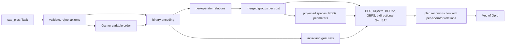

# symbolic-search design

State-set search over SAS+ tasks with binary decision diagrams (BDDs). A
search step maps a whole set of states, represented as one BDD, through the
transition relation at once. The crate targets cost-optimal planning:
symbolic BFS and Dijkstra, bidirectional search, BDDA\*, SymBA\* and, later,
symbolic abstraction heuristics.

Input is a `sas_plus::Task` (crates.io `sas-plus` 0.2.1). Output is a
sequential plan as a `Vec<sas_plus::OpId>` in execution order.

## Pipeline



Code map:

| Module | Role |
|---|---|
| `backend` | `Backend` trait, the only place that knows the BDD library |
| `backend::bcdd` | `Backend` on `oxidd` complement-edge BDDs |
| `order` | static variable orders (task order, Gamer) |
| `encoding` | bit layout, fact, state, validity and frame-axiom BDDs |
| `relation` | transition relations, image, preimage, merged groups, projection |
| `model` | compiled task, unit-cost BFS, cost-aware plan reconstruction |
| `model::space` | a searchable space: groups plus initial and goal sets |
| `model::frontier` | one search direction: open buckets by `(g, h)`, closed layers |
| `model::heuristic` | heuristics as a partition of BDDs by `h` value |
| `model::best_first` | unidirectional Dijkstra, BDDA\*, GBFS |
| `model::bidirectional` | bidirectional search with meeting checks |
| `model::abstraction` | variable-dropping projections, PDBs, perimeters |
| `model::symba` | SymBA\* driver |
| `search` | public `SymbolicTask`, `Config`, `Heuristic` |

## SAS+ to binary encoding

**Log encoding.** A variable with domain size `d` gets `⌈log₂ d⌉` bits
and value `k` is stored as its binary code, most significant bit first.
A single-value variable gets zero bits.

**One-hot was rejected for now.** One-hot uses `d` bits per variable plus an
exactly-one constraint. It makes fact tests single literals, but it costs
more BDD variables and mutex reasoning that the log encoding gets for free.
Gamer and SymBA\* use the log encoding. One-hot stays an option per variable
if a domain turns out to profit, for example a large domain with
mostly-singleton preconditions.

**Invalid codes.** When `d` is not a power of two, codes `≥ d` encode no
state. They never appear in forward search from the valid initial state.
Backward search starts from a partial goal, and a preimage through an
unconditional effect frees the bits of that variable. So:

- the goal set is conjoined with `valid(x)` for all variables;
- each operator relation contains `valid_v(x)` for every affected `v`.

Untouched variables keep their (valid) bits, so every set stays inside the
valid codes. Plan correctness does not depend on this, because invalid
states never connect to the initial state. Set sizes and state counts do,
and so will heuristics and bidirectional meeting tests. A unit test pins it.

**Variable order.** Each bit has a current copy `x` and a next copy `x'`,
and the two are adjacent ("interleaved"):

```text
level:  0      1      2      3      ...
bit:    v0.b0  v0.b0' v0.b1  v0.b1' v1.b0  v1.b0' ...
```

Interleaving keeps relations of the form `x' = f(x)` linear in size; with
all current bits above all next bits, a single frame axiom `x' = x` is
already exponential. Across SAS+ variables, the default is Gamer's static
order, which places dependent variables close together by approximating a
linear arrangement problem over the causal graph (Kissmann and Edelkamp
2011): minimise `Σ (pos(u) − pos(v))²` over causal-graph arcs. Gamer
optimises from random starts; this crate starts from the task order and
runs deterministic pairwise-swap hill climbing (at most 32 sweeps), so runs
are reproducible. `VariableOrder::Task` keeps the task order. The order is
set before any node exists. Dynamic reordering (sifting) is out of scope: the chosen
backend does not offer it (see below), and the planners this design
follows use a static order.

## Transition relation

**Per-operator relations, without full frame axioms.** Each operator `o`
gets its own relation over the variables it touches:

```text
T_o(x, x') = pre_o(x) ∧ ⋀_{v ∈ eff(o)} valid_v(x) ∧ E_v(x, x')
```

Variables outside `eff(o)` get no frame axiom `v' = v`. Instead, image and
preimage quantify and rename only the bits of `eff(o)`. Untouched bits pass
through, and relations stay small: they do not grow with the number of
task variables.

**Conditional effects.** `sas_plus::Task::apply` evaluates effect conditions
in the pre-state and applies effects in list order, so the last firing
effect on a variable wins. With effects `(C₁ → a₁) … (C_k → a_k)` on `v`
in operator order:

```text
E_v = ite(C_k, v' = a_k, ite(C_{k-1}, v' = a_{k-1}, … ite(C₁, v' = a₁, v' = v)))
```

Here `v' = v` is the frame axiom of `v` alone, used when no effect on `v`
fires. Unconditional effects collapse to `v' = a`. A test pins the
"last wins" order.

**Partitioning.** Options from the literature:

- *Monolithic* `T = ⋁_o T_o`: one relational product per step, but `T`
  explodes quickly.
- *Disjunctive partitioning* (the base form, with `merge_node_limit` 0:
  one part per operator): `image(S) = ⋁_o image_o(S)`. Plan reconstruction
  needs per-operator parts anyway.
- *Merged disjunctive groups* (implemented): operators of one cost are
  merged, in operator order, while the merged BDD stays within
  `Config::merge_node_limit` nodes (default 100 000, the SymBA\* default;
  0 keeps one relation per operator). The merged parts share a
  quantification set (the union of affected variables) and get explicit
  frame axioms for the variables only some members touch. SymBA\* merges in
  a balanced tree; greedy sequential merging is simpler and was enough so
  far. Per-operator relations are kept for reconstruction. A unit test pins
  that group images and preimages equal the union of the operators'.
- *Conjunctive partitioning* (Burch, Clarke and Long 1991; implemented as
  `Partitioning::Conjunctive`): `T = ⋀_i T_i` with early quantification.
  A disjunction of operators does not distribute over conjuncts, so only
  single operators are split: `T_o = pre_rest ∧ ⋀_{v ∈ eff(o)} C_v` with
  `C_v = pre_v ∧ valid_v ∧ E_v`, one relation per operator and no merging.
  Untouched variables keep their frame because they are never quantified.
  The schedule is greedy in the IWLS95 spirit: the precondition conjunct
  first, then the conjunct that retires the most affected variables, ties
  to the smaller support. Consecutive conjuncts are clustered while a
  cluster has at most `cluster_node_limit` nodes. The image quantifies the
  current bits of `v` after the last cluster that mentions `v`; the
  preimage quantifies the next bits of `v` after `C_v`'s cluster. Projected
  relations (PDBs, SymBA\* perimeters) stay monolithic, since `∃` does not
  distribute over `∧`. A unit test pins that images and preimages equal the
  union of the monolithic operator relations, at cluster limits 0 to
  `usize::MAX`, from all valid states and from every BFS layer of 16
  random tasks with conditional effects.
- *Cost grouping* (implemented): groups never mix costs, so a search step
  files each group's image at `g + cost`. BFS ignores the costs and unions
  all groups.

**Axioms** are rejected with `Error::Axioms`. Speck et al.
(2019) encode derived variables symbolically, either by compiling the axiom
fixpoint into a BDD per derived variable or by evaluating it per layer. The
first fits `sas-plus` semantics (layered, negation by failure) and is
planned for milestone 4.

## Image and preimage

Image and preimage use the relational product `∃ vars. a ∧ b`, computed in
one pass (oxidd `apply_exists`):

```text
image_o(S)    = (∃ x_eff. S ∧ T_o)[x'_eff ↦ x_eff]
preimage_o(S) =  ∃ x'_eff. S[x_eff ↦ x'_eff] ∧ T_o
```

Quantification sets and renamings are built once per operator and reused.
oxidd caches substitutions by id, so reusing one renaming keeps hitting the
apply cache.

## Layered BFS and plan extraction

Forward BFS (unit cost):

```text
L₀ = {s₀};  R = L₀
repeat:
    if Lᵢ ∧ G ≠ ⊥: done
    Lᵢ₊₁ = (⋁_o image_o(Lᵢ)) ∧ ¬R     # fresh states only
    if Lᵢ₊₁ = ⊥: unsolvable
    R = R ∨ Lᵢ₊₁
```

All layers stay in memory; they are disjoint, and plan reconstruction needs
them. Reconstruction picks one concrete state `sₙ ∈ Lₙ ∧ G`. Then, for
`i = n … 1`, it searches the operators for one with
`preimage_o({sᵢ}) ∧ Lᵢ₋₁ ≠ ⊥`, picks `sᵢ₋₁` there, and records `o`. The
operators come out reversed. Every state of `Lᵢ` has a predecessor in
`Lᵢ₋₁`, so the walk never gets stuck.

Backward BFS swaps the roles: it starts from `G ∧ valid` with preimages and
stops at the layer that contains `s₀`. Reconstruction walks forward from
`s₀` with images into `Lᵢ₋₁` and records the operators in execution order.

A concrete state comes from one satisfying cube of the set, with open bits
set to 0. Any completion of a cube is a member of the set, and sets stay
inside valid codes, so the decoded state is a real state of the set.

Both directions return a plan of minimum length. When the initial state
already satisfies the goal, the plan is empty.

## Cost handling (Dijkstra, BDDA\*, GBFS, SymBA\*)

One frontier type (`model::frontier`) runs all cost-aware searches, in
either direction and in the concrete or a projected space.

- **Open** maps a key to a BDD. New states at cost `g` are split by the
  heuristic partition and filed under `(g + h, larger g first)` (Dijkstra,
  BDDA\*) or `(h, smaller g first)` (GBFS). Dijkstra is BDDA\* with the blind
  partition `{h = 0: ⊤}`. States outside the partition are dead ends and are
  dropped.
- **Closed** is a list of `(g, set)` entries in expansion order, plus their
  union per `g`. A pop subtracts the states closed at a cost `≤ g` (any cost
  for GBFS). So a state is reopened only when found more cheaply, which keeps
  BDDA\* optimal for admissible but inconsistent heuristics, and zero-cost
  cycles terminate. Zero-cost successors land in the bucket being expanded
  and are popped next; no separate BFS closure is needed.
- **Goal test** on pop: the first popped set that meets the target gives an
  optimal plan for an admissible heuristic.
- **Reconstruction.** A state filed at cost `g` is the start at `g = 0`, or
  was generated by an operator of cost `c` from a closed entry with cost
  `g − c` that comes earlier in the list. The walk picks a concrete state,
  then repeatedly finds an operator `o` and an earlier entry with cost
  `g − cost(o)` that `o` connects to, until it stands on the start at
  `g = 0`. The entry index strictly decreases, so zero-cost steps cannot
  cycle.
- **Heuristics** are a partition `(h, BDD)` sorted by `h`, disjoint, with the
  complement read as dead ends. The maximum of two partitions is their
  pairwise intersection. A partition can come from a symbolic PDB, a SymBA\*
  perimeter, or explicit estimates per partial state. An ADD or MTBDD
  representation (oxidd has MTBDDs) stays an option.
- **Bidirectional search.** Each step expands the side whose next bucket has
  fewer BDD nodes. Newly closed sets and newly generated sets are
  intersected with the other side's closed layers per `g` and with its start
  set (counted as closed at cost 0). The search stops when the best meeting
  costs at most `max(f_min(fwd), f_min(bwd), g_min(fwd) + g_min(bwd))`. The
  rustdoc of `model::bidirectional` sketches why this is a lower bound on
  any unmet plan. The plan is the forward walk reversed, then the backward
  walk.
- **Projections and PDBs.** Dropping variables quantifies their current and
  next bits out of every group, after restricting them to valid codes.
  Without that restriction an invalid code disables every conditional effect
  on it and adds spurious "no effect fires" transitions. Abstract sets then
  never mention the dropped bits. A PDB is a blind backward Dijkstra to
  exhaustion in the projection; the closed layers per `g` are the partition,
  and the rest is dead. The projection is the exact induced abstraction, so
  with conditional effects it can be more informed than
  `sas_plus::Projection`, which lets an uncertain effect fire or not.
- **SymBA\*.** Both sides start blind (bidirectional Dijkstra). Each side
  owns an abstraction hierarchy: level `k` drops `k` variables (non-goal
  variables first, from the last id down), and projected spaces are built
  on first use. When the side about to expand has a next bucket over
  `SymbaConfig::frontier_node_limit`, it first gets one slice of abstract
  work: its abstract search (blind, in the opposite direction) runs for
  `abstract_slice` expansions and pauses. The search is kept and resumed on
  the next slice instead of restarting. When its next bucket passes
  `abstract_node_limit`, it is frozen and the next level starts; when it is
  exhausted, it is exact for its abstraction and coarser levels cannot beat
  it, so the side stops abstract work. Closed abstract states get their
  distance, all others the smallest open cost (the perimeter), or dead when
  the search ran out. The side's heuristic is the maximum of the frozen
  perimeters and the current one; open is refiled under it, and blind
  results are skipped. Perimeters at every pause point are admissible and
  consistent, and so is the maximum, so the bidirectional bound stays
  valid. A unit test pins that a search paused after every expansion ends
  with the perimeter of an uninterrupted run. `max_expansions` and
  `time_limit` cap concrete plus abstract expansions and fail with
  `Error::BudgetExhausted`, never with "unsolvable". `symba(limit)` sets
  both node limits to `limit` with unbounded slices and no budget. Not done
  compared to Torralba et al.: time-based step estimates, a hierarchy
  chosen by abstract search cost, merge-and-shrink abstractions.

## Backend comparison and choice

Crates looked at in November 2026. "Observed" means read in the source or
the crates.io metadata; nothing was benchmarked here.

| Crate | Version, updated | License | Reordering | Relational product, renaming | Notes |
|---|---|---|---|---|---|
| `oxidd` | 0.13.0, 2026-09 | MIT OR Apache-2.0 | static reorder to a given order, plus an `unsafe` adjacent-level swap primitive (`oxidd-reorder` 0.8.0). No sifting | `apply_exists` (fused and-exists), parallel `substitute` with cached substitution ids | shared manager with unique table and apply cache; BDD, BCDD, ZBDD, MTBDD, TDD; fixed node capacity with GC; fallible allocation; MSRV 1.91; TACAS 2024 paper; multi-threading optional |
| `biodivine-lib-bdd` | 0.6.3, 2026-02 | MIT | none, static order | `binary_op_with_exists`; `substitute` one variable at a time; bulk `rename_variables` is an `unsafe fn` (renames nodes in place, "non-semantic" per its docs) | `pub struct Bdd(Vec<BddNode>)`: each diagram is its own node vector, with no node sharing across sets and no shared cache; simple API; MSRV 1.88 |
| `cudd-sys` / `cudd` | 1.1.1, 2025-12 / 0.1.4, 2023-04 | bindings CC0 / MIT | upstream CUDD has sifting (not checked here) | upstream CUDD has and-abstract (not checked here) | FFI: needs a C build and calls into `unsafe`, which the crate's `unsafe_code = "forbid"` rules out without a wrapper; the safe `cudd` wrapper was last updated in 2023 |
| `sylvan-sys` | 1.1.0, 2023-01 | Apache-2.0 | not checked | upstream Sylvan has relational products (not checked here) | FFI, last updated 2023 |
| `ruddy` | 0.0.2, 2025-11 | MIT | not checked | not checked | early, about 100 downloads |

Not evaluated: crates whose crates.io lookup failed (`lumindd`, `rsdd` under
those names) and general Boolean-expression crates with BDD side features
(`boolean_expression`).

**Choice: `oxidd`, complement-edge BDDs (`bcdd`), index-based manager,
single thread.** Reasons:

1. A shared manager with a unique table and an apply cache, the
   CUDD-style architecture all symbolic planners rely on. Layers, relations
   and heuristic BDDs share nodes. `biodivine-lib-bdd` copies every
   diagram.
2. The fused relational product and bulk parallel substitution are exactly
   the image and preimage primitives.
3. Fallible allocation and a hard node capacity. Search reports
   `Error::OutOfMemory` instead of aborting, and tests can cap memory.
4. Dual MIT OR Apache-2.0 license, actively maintained, and a peer-reviewed
   design. MTBDDs are there if an ADD heuristic is wanted later.
5. Static reordering covers the static variable order. Sifting is
   missing in both pure-Rust crates inspected (oxidd and biodivine).

Costs of the choice:

- MSRV goes from 1.85 to 1.91.
- The `with_manager_*` closure API is more involved, but it stays inside
  `backend::bcdd`.
- The dependency tree is larger (proc macros, `parking_lot`, a bigint
  crate).

Features are trimmed to `manager-index`, `bcdd` and
`apply-cache-direct-mapped`. Multi-threaded apply is a later experiment.

**The seam.** `backend::Backend` (crate-private) has associated types `Set`,
`VarSet` (prebuilt quantification set) and `Renaming` (prebuilt renaming),
and only the operations the crate calls: constants, literals, `not`, `and`,
`or`, `ite`, `and_exists`, `rename`, emptiness and `pick`. Every operation
that allocates returns `Result<_, OutOfMemory>`. No oxidd type appears in a
public signature or error. Swapping the backend means one new module, plus
a type parameter or a feature on `SymbolicTask`.

The 0.0.0 placeholder trait `SymbolicTransitions` (infallible `image`,
`preimage`) was dropped. Its infallible signatures cannot report a full
node table. A public trait for state-set transitions comes back if another
crate needs one (see "Cross-crate needs").

## Testing strategy

- **BFS oracle.** A plain explicit-state BFS over `sas_plus::State`s
  (`tests/it/oracle.rs`) gives the optimal unit-cost plan length. Both
  symbolic BFS directions must return plans of exactly that length, and
  `Task::validate_plan(plan).is_some()` must hold. BFS ignores costs, so
  its plan cost is not compared.
- **Random tasks.** `sas_plus::random::random_task` sweeps 64 seeds per
  parameter set: the defaults, domains up to 5 (invalid codes), and
  conditional effects with up to two conditions. Each sweep asserts that
  it saw trivial (length 0), deep (length 2 or more) and unsolvable tasks,
  so it cannot pass vacuously. Seeds are plain loops, so no `proptest` is
  needed.
- **Fixtures.** The four hand-encoded Fast Downward files, copied from
  `sas-plus/tests/fixtures`: `gripper-unit` (optimum 5), `gripper-costs`
  (matches the unit-cost oracle, not the cost optimum 7),
  `conditional-effects`, and `derived-predicates` (expects
  `Error::Axioms`). The GPL-licensed `translated/` inputs are not copied.
- **Hand-built edge cases.** Last conditional effect wins, goal true
  initially (empty plan both ways), a single-value variable (zero bits),
  and no operators (unsolvable).
- **Unit tests.** Backend relational product and rename, `pick` with open
  variables, out-of-memory on a tiny table, bit widths, and backward layers
  staying inside valid codes.
- **Costs.** An explicit-state Dijkstra (`tests/it/oracle.rs`) gives the
  optimal cost. Forward, backward and bidirectional Dijkstra and SymBA\*
  (node limits 1 and 8, which abstract, `usize::MAX`, which never
  does, abstract searches paused after every expansion, and the default
  `SymbaConfig`) must return plans whose `Task::validate_plan` cost equals it, on
  random sweeps with costs 1 to 5. Sweeps assert they saw trivial, solved
  and unsolvable tasks, and the default and wide sweeps also a task where
  the BFS plan is not cost-optimal. Hand-built tasks cover zero-cost
  cycles, a zero-cost last step and all-zero costs; `gripper-costs` must
  cost 7.
- **Heuristics.** BDDA\* with a goal-variable PDB, with `h*` on the reachable
  states, and with an inconsistent admissible variant of `h*` must be
  optimal. GBFS with the PDB must find a plan exactly when one exists. PDB
  values equal `sas_plus::Projection` goal distances on every reachable
  state without conditional effects, and lie between them and `h*` with
  them.
- **Options.** Every oracle check runs under three configs: merged groups
  with the Gamer order, one relation per operator with the task order, and
  conjunctive clusters of one conjunct each.
- **Unit tests.** Merged groups step like the union of their operators;
  SymBA\* with node limits 1 to 16 installs informative (not
  blind) perimeters; partition maximum and
  overlap rules; Gamer pulls linked variables together.
- **Memory.** Tests use `node_capacity` 2¹⁵ and `cache_capacity` 2¹² (unit
  tests 2¹² and 2⁸); a test that exceeds them fails loudly.
- **Bench.** `benches/search.rs` runs each search on `gripper-costs`.
- **Later.** Comparisons against Fast Downward's symbolic search or SymBA\*
  on translated IPC tasks, outside CI.

## Milestones

1. **Done.** Encoding, per-operator relations with conditional effects,
   forward and backward symbolic BFS, layered plan reconstruction, oxidd
   backend behind `Backend`.
2. **Done.** Gamer static variable order; merged disjunctive groups per
   cost; symbolic Dijkstra forward, backward and bidirectional with
   cost-aware reconstruction; BDDA\* and GBFS with partition heuristics;
   symbolic PDBs; SymBA\* with variable-dropping perimeter abstractions.
3. **Partly done.** Conjunctive partitioning with early quantification;
   SymBA\* with resumable abstract searches, separate node limits and a
   budget. **Next:** search statistics (layers, nodes, peak); time-based
   direction choice; balanced-tree group merging; a better SymBA\*
   abstraction hierarchy.
4. **Axioms**, following Speck et al. (2019). State-invariant (mutex)
   pruning when `sas-plus` provides mutex groups.
5. **Merge-and-shrink** heuristics as BDD partitions.

## Cross-crate needs

- **MSRV.** oxidd needs Rust 1.91, and so does this crate. `miniplan`
  depends on `symbolic-search` in the architecture graph, so it inherits
  1.91 once it depends on this crate.
- **sas-plus: mutex groups on `Task`.** `SasFile::mutex_groups` holds them,
  but `SasFile::to_task` drops them, so tasks from other sources have none.
  Symbolic search uses them for state-invariant pruning (Torralba et al.
  2017). Wanted: an optional `mutex_groups` field on `Task`, or a separate
  invariant type that the translator and the generators can fill.
- **sas-plus: causal graph weights.** `CausalGraph` exposes unweighted
  `successors` and `predecessors`, which is enough for Gamer's order. Edge
  weights (the number of operators that induce an edge) would help as a
  tie breaker. Nice to have.
- **merge-and-shrink: BDD export.** For milestone 5, a way to turn an
  abstraction (`abstract_state` plus goal distances) into BDDs per `h`
  value. Without an export, symbolic-search would rebuild the mapping
  through `sas_plus::Abstraction`, which works state by state and so needs a
  factored representation of the mapping. Status lists "No BDD export".
- **Shared transition trait.** If `miniplan` wants to drive symbolic search
  through a trait, a fallible `image` and `preimage` trait could move to
  `search-core` once a second crate needs it.

## Open questions

- Accept or bump the MSRV to 1.91 across the ecosystem?
- Should the public API become generic over the backend (feature flag or
  type parameter) once a second backend exists, or stay concrete?
- Plan type: `Vec<OpId>` now. Should a shared `Plan` type live in
  `sas-plus`?
- Axioms: which of the encodings of Speck et al. (2019) to implement?
- Default `Config` capacities: 2²⁰ nodes (about 16 bytes per node plus its
  unique-table slot, so a few dozen MiB) and 2¹⁸ cache entries (a few dozen
  bytes each). Sizing is static (oxidd does not grow the table). Bigger
  defaults, a size derived from the task, or a retry with a larger manager
  on `OutOfMemory`?
- Default `merge_node_limit` 100 000 (SymBA\*'s value) and Gamer as the
  default order: keep, or tune on IPC tasks?
- `SymbolicTask::symba` takes only a node limit. Should it get a parameter
  struct (abstraction order, separate abstract-search limit, time budget)?
- Plans are returned without their cost; `Task::validate_plan` gives it.
  Return `(plan, cost)` instead?

## References

Venues and DOIs were checked online, except for the first three entries
(authors, title and year only).

- R. E. Bryant. Graph-based algorithms for Boolean function manipulation.
  1986.
- J. R. Burch, E. M. Clarke, D. E. Long. Symbolic model checking with
  partitioned transition relations. 1991.
- R. Rudell. Dynamic variable ordering for ordered binary decision
  diagrams. 1993.
- S. Edelkamp, F. Reffel. OBDDs in heuristic search. KI 1998, LNCS 1504.
  BDDA\*.
- R. M. Jensen, R. E. Bryant, M. M. Veloso. SetA\*: An efficient BDD-based
  heuristic search algorithm. AAAI 2002, 668–673.
- P. Kissmann, S. Edelkamp. Improving cost-optimal domain-independent
  symbolic planning. AAAI 2011, 992–997. doi:10.1609/aaai.v25i1.8009.
  Gamer.
- Á. Torralba, V. Alcázar, D. Borrajo, P. Kissmann, S. Edelkamp. SymBA\*: A
  symbolic bidirectional A\* planner. International Planning Competition
  2014, 105–108. Winner of the optimal track.
- Á. Torralba, C. Linares López, D. Borrajo. Abstraction heuristics for
  symbolic bidirectional search. IJCAI 2016, 3272–3278. SymBA\* in depth.
- Á. Torralba, V. Alcázar, P. Kissmann, S. Edelkamp. Efficient symbolic
  search for cost-optimal planning. Artificial Intelligence 242:52–79, 2017.
  doi:10.1016/j.artint.2016.10.001.
- D. Speck, F. Geißer, R. Mattmüller, Á. Torralba. Symbolic planning with
  axioms. ICAPS 2019. doi:10.1609/icaps.v29i1.3511.
- N. Husung, C. Dubslaff, H. Hermanns, M. A. Köhl. OxiDD: A safe,
  concurrent, modular, and performant decision diagram framework in Rust.
  TACAS 2024. doi:10.1007/978-3-031-57256-2_13.
