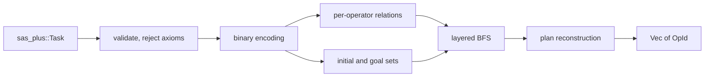

# symbolic-search design

State-set search over SAS+ tasks with binary decision diagrams (BDDs). A
search step maps a whole set of states, represented as one BDD, through the
transition relation at once. The crate targets cost-optimal planning:
symbolic BFS and Dijkstra, bidirectional search, BDDA\*, SymBA\* and, later,
symbolic abstraction heuristics.

Input is a `sas_plus::Task` (crates.io `sas-plus` 0.2.1). Output is a
sequential plan as a `Vec<sas_plus::OpId>` in execution order.

## Pipeline



Code map:

| Module | Role |
|---|---|
| `backend` | `Backend` trait, the only place that knows the BDD library |
| `backend::bcdd` | `Backend` on `oxidd` complement-edge BDDs |
| `encoding` | bit layout, fact, state, validity and frame-axiom BDDs |
| `relation` | per-operator transition relation, image, preimage |
| `model` | compiled task, layered BFS, plan reconstruction |
| `search` | public `SymbolicTask` and `Config` |

## SAS+ to binary encoding

**Log encoding.** A variable with domain size `d` gets `⌈log₂ d⌉` bits
and value `k` is stored as its binary code, most significant bit first.
A single-value variable gets zero bits.

**One-hot was rejected for now.** One-hot uses `d` bits per variable plus an
exactly-one constraint. It makes fact tests single literals, but it costs
more BDD variables and mutex reasoning that the log encoding gets for free.
Gamer and SymBA\* use the log encoding. One-hot stays an option per variable
if a domain turns out to profit, for example a large domain with
mostly-singleton preconditions.

**Invalid codes.** When `d` is not a power of two, codes `≥ d` encode no
state. They never appear in forward search from the valid initial state.
Backward search starts from a partial goal, and a preimage through an
unconditional effect frees the bits of that variable. So:

- the goal set is conjoined with `valid(x)` for all variables;
- each operator relation contains `valid_v(x)` for every affected `v`.

Untouched variables keep their (valid) bits, so every set stays inside the
valid codes. Plan correctness does not depend on this, because invalid
states never connect to the initial state. Set sizes and state counts do,
and so will heuristics and bidirectional meeting tests. A unit test pins it.

**Variable order.** Each bit has a current copy `x` and a next copy `x'`,
and the two are adjacent ("interleaved"):

```text
level:  0      1      2      3      ...
bit:    v0.b0  v0.b0' v0.b1  v0.b1' v1.b0  v1.b0' ...
```

Interleaving keeps relations of the form `x' = f(x)` linear in size; with
all current bits above all next bits, a single frame axiom `x' = x` is
already exponential. Across SAS+ variables, milestone 1 keeps the task's
order. Planned: Gamer's causal-graph-based order. It places variables that
interact in the causal graph close together, by local search over
permutations that minimizes summed squared distances of connected
variables (Kissmann and Edelkamp 2011). The order is static and set before
any node exists. Dynamic reordering (sifting) is not needed for planning
benchmarks in practice, and the chosen backend does not offer it (see
below).

## Transition relation

**Per-operator relations, without full frame axioms.** Each operator `o`
gets its own relation over the variables it touches:

```text
T_o(x, x') = pre_o(x) ∧ ⋀_{v ∈ eff(o)} valid_v(x) ∧ E_v(x, x')
```

Variables outside `eff(o)` get no frame axiom `v' = v`. Instead, image and
preimage quantify and rename only the bits of `eff(o)`. Untouched bits pass
through, and relations stay small: they do not grow with the number of
task variables.

**Conditional effects.** `sas_plus::Task::apply` evaluates effect conditions
in the pre-state and applies effects in list order, so the last firing
effect on a variable wins. With effects `(C₁ → a₁) … (C_k → a_k)` on `v`
in operator order:

```text
E_v = ite(C_k, v' = a_k, ite(C_{k-1}, v' = a_{k-1}, … ite(C₁, v' = a₁, v' = v)))
```

Here `v' = v` is the frame axiom of `v` alone, used when no effect on `v`
fires. Unconditional effects collapse to `v' = a`. A test pins the
"last wins" order.

**Partitioning.** Options from the literature:

- *Monolithic* `T = ⋁_o T_o`: one relational product per step, but `T`
  explodes quickly.
- *Disjunctive partitioning* (what milestone 1 does in its simplest form,
  one part per operator): `image(S) = ⋁_o image_o(S)`. Plan reconstruction
  needs per-operator parts anyway.
- *Merged disjunctive groups*: merge operator relations, in a balanced tree,
  up to a node threshold (SymBA\* uses about 100 000 nodes), so one step
  does fewer relational products. The merged parts need a shared
  quantification set (the union of affected variables) and explicit frame
  axioms for the variables only some members touch. Planned for milestone 3,
  with per-operator relations kept for reconstruction.
- *Conjunctive partitioning* (Burch, Clarke and Long 1991): `T = ⋀_i T_i`
  with early quantification. Fits synchronous systems; for interleaving
  planning operators the disjunctive form is the natural one. Not planned.
- *Cost grouping*: for Dijkstra, BDDA\* and SymBA\*, relations are grouped by
  operator cost first, then merged within a cost.

**Axioms** are rejected with `Error::Axioms` in milestone 1. Speck et al.
(2019) encode derived variables symbolically, either by compiling the axiom
fixpoint into a BDD per derived variable or by evaluating it per layer. The
first fits `sas-plus` semantics (layered, negation by failure) and is
planned for milestone 4.

## Image and preimage

Image and preimage use the relational product `∃ vars. a ∧ b`, computed in
one pass (oxidd `apply_exists`):

```text
image_o(S)    = (∃ x_eff. S ∧ T_o)[x'_eff ↦ x_eff]
preimage_o(S) =  ∃ x'_eff. S[x_eff ↦ x'_eff] ∧ T_o
```

Quantification sets and renamings are built once per operator and reused.
oxidd caches substitutions by id, so reusing one renaming keeps hitting the
apply cache.

## Layered BFS and plan extraction

Forward BFS (unit cost):

```text
L₀ = {s₀};  R = L₀
repeat:
    if Lᵢ ∧ G ≠ ⊥: done
    Lᵢ₊₁ = (⋁_o image_o(Lᵢ)) ∧ ¬R     # fresh states only
    if Lᵢ₊₁ = ⊥: unsolvable
    R = R ∨ Lᵢ₊₁
```

All layers stay in memory; they are disjoint, and plan reconstruction needs
them. Reconstruction picks one concrete state `sₙ ∈ Lₙ ∧ G`. Then, for
`i = n … 1`, it searches the operators for one with
`preimage_o({sᵢ}) ∧ Lᵢ₋₁ ≠ ⊥`, picks `sᵢ₋₁` there, and records `o`. The
operators come out reversed. Every state of `Lᵢ` has a predecessor in
`Lᵢ₋₁`, so the walk never gets stuck.

Backward BFS swaps the roles: it starts from `G ∧ valid` with preimages and
stops at the layer that contains `s₀`. Reconstruction walks forward from
`s₀` with images into `Lᵢ₋₁` and records the operators in execution order.

A concrete state comes from one satisfying cube of the set, with open bits
set to 0. Any completion of a cube is a member of the set, and sets stay
inside valid codes, so the decoded state is a real state of the set.

Both directions return a plan of minimum length. When the initial state
already satisfies the goal, the plan is empty.

## Cost handling (Dijkstra, BDDA\*, SymBA\*)

Planned for milestones 2 and 3. The design follows Torralba et al. (2017):

- **Dijkstra.** Open is a map `g → BDD`, a bucket per distinct cost. Expand
  the cheapest bucket. Zero-cost operators get a BFS closure within the
  bucket before cost > 0 operators fire. Closed is the union of expanded
  buckets. Relations are grouped per operator cost.
- **Plan extraction with costs.** Keep the closed set per `g` value. Walk
  back from the goal state with cost-`c` relations into the bucket
  `g − c`. Zero-cost steps walk back within one bucket through its BFS
  sublayers, so the sublayers are stored as well.
- **BDDA\*.** Open is a matrix `(g, h) → BDD`. `h` comes from a heuristic
  that partitions a set by value: a symbolic PDB as a list of BDDs per
  `h` value, or an explicit heuristic evaluated by splitting the set.
  Expand the bucket with minimal `f`, and break ties by maximal `g`. An ADD
  or MTBDD heuristic representation (oxidd has MTBDDs) is an option, but
  the BDD-per-value form is what SymBA\* uses, and it needs only the
  `Backend` trait.
- **Bidirectional Dijkstra.** Stop when `g_f + g_b ≥` the best meeting
  cost. The meeting test is `closed_f(g) ∧ frontier_b(g')`. Step selection
  prefers the direction whose last step was cheaper in time or nodes.
- **SymBA\*.** Bidirectional A\* that switches between perimeter
  abstractions in each direction, keeping the best plan found. It needs
  symbolic abstraction heuristics (milestone 5).

## Backend comparison and choice

Crates looked at in November 2026. "Observed" means read in the source or
the crates.io metadata; nothing was benchmarked here.

| Crate | Version, updated | License | Reordering | Relational product, renaming | Notes |
|---|---|---|---|---|---|
| `oxidd` | 0.13.0, 2026-09 | MIT OR Apache-2.0 | static reorder to a given order, plus an `unsafe` adjacent-level swap primitive (`oxidd-reorder` 0.8.0). No sifting | `apply_exists` (fused and-exists), parallel `substitute` with cached substitution ids | shared manager with unique table and apply cache; BDD, BCDD, ZBDD, MTBDD, TDD; fixed node capacity with GC; fallible allocation; MSRV 1.91; TACAS 2024 paper; multi-threading optional |
| `biodivine-lib-bdd` | 0.6.3, 2026-02 | MIT | none, static order | `binary_op_with_exists`; `substitute` one variable at a time, no bulk rename | each `Bdd` is a standalone node vector, so there is no node sharing across sets or global cache; simple, safe API; MSRV 1.88; heavily used in systems biology |
| `cudd-sys` / `cudd` | 1.1.1, 2025-12 / 0.1.4, 2023-04 | CC0 bindings, CUDD BSD-3 | full CUDD (sifting and more) | full CUDD | FFI: needs a C build and `unsafe`, which conflicts with `unsafe_code = "forbid"`; the safe `cudd` wrapper is stale |
| `sylvan-sys` | 1.1.0, 2023-01 | Apache-2.0 | Sylvan (limited) | yes | FFI, stale |
| `ruddy` | 0.0.2, 2025-11 | MIT | not checked | not checked | early, about 100 downloads |

Not evaluated: crates whose crates.io lookup failed (`lumindd`, `rsdd` under
those names) and general Boolean-expression crates with BDD side features
(`boolean_expression`).

**Choice: `oxidd`, complement-edge BDDs (`bcdd`), index-based manager,
single thread.** Reasons:

1. A shared manager with a unique table and an apply cache, the
   CUDD-style architecture all symbolic planners rely on. Layers, relations
   and heuristic BDDs share nodes. `biodivine-lib-bdd` copies every
   diagram.
2. The fused relational product and bulk parallel substitution are exactly
   the image and preimage primitives.
3. Fallible allocation and a hard node capacity. Search reports
   `Error::OutOfMemory` instead of aborting, and tests can cap memory.
4. Dual MIT OR Apache-2.0 license, actively maintained, and a peer-reviewed
   design. MTBDDs are there if an ADD heuristic is wanted later.
5. Static reordering covers what planners do (a static order chosen up
   front). Sifting is missing in every pure-Rust option.

Costs of the choice:

- MSRV goes from 1.85 to 1.91.
- The `with_manager_*` closure API is more involved, but it stays inside
  `backend::bcdd`.
- The dependency tree is larger (proc macros, `parking_lot`, a bigint
  crate).

Features are trimmed to `manager-index`, `bcdd` and
`apply-cache-direct-mapped`. Multi-threaded apply is a later experiment.

**The seam.** `backend::Backend` (crate-private) has associated types `Set`,
`VarSet` (prebuilt quantification set) and `Renaming` (prebuilt renaming),
and only the operations the crate calls: constants, literals, `not`, `and`,
`or`, `ite`, `and_exists`, `rename`, emptiness and `pick`. Every operation
that allocates returns `Result<_, OutOfMemory>`. No oxidd type appears in a
public signature or error. Swapping the backend means one new module, plus
a type parameter or a feature on `SymbolicTask`.

The 0.0.0 placeholder trait `SymbolicTransitions` (infallible `image`,
`preimage`) was dropped. Its infallible signatures cannot report a full
node table. A public trait for state-set transitions comes back if another
crate needs one (see "Cross-crate needs").

## Testing strategy

- **Oracle.** A plain explicit-state BFS over `sas_plus::State`s
  (`tests/it/oracle.rs`) gives the optimal unit-cost plan length. Both
  symbolic directions must return plans of exactly that length, and
  `Task::validate_plan(plan).is_some()` must hold. Plan cost is not
  compared, because random tasks and `gripper-costs` have non-unit costs.
- **Random tasks.** `sas_plus::random::random_task` sweeps 64 seeds per
  parameter set: the defaults, domains up to 5 (invalid codes), and
  conditional effects with up to two conditions. Each sweep asserts that
  it saw trivial (length 0), deep (length 2 or more) and unsolvable tasks,
  so it cannot pass vacuously. Seeds are plain loops, so no `proptest` is
  needed.
- **Fixtures.** The four hand-encoded Fast Downward files, copied from
  `sas-plus/tests/fixtures`: `gripper-unit` (optimum 5), `gripper-costs`
  (matches the unit-cost oracle, not the cost optimum 7),
  `conditional-effects`, and `derived-predicates` (expects
  `Error::Axioms`). The GPL-licensed `translated/` inputs are not copied.
- **Hand-built edge cases.** Last conditional effect wins, goal true
  initially (empty plan both ways), a single-value variable (zero bits),
  and no operators (unsolvable).
- **Unit tests.** Backend relational product and rename, `pick` with open
  variables, out-of-memory on a tiny table, bit widths, and backward layers
  staying inside valid codes.
- **Memory.** Tests use `node_capacity` 2¹⁵ and `cache_capacity` 2¹²; a test
  that exceeds them fails loudly.
- **Later.** Dijkstra cost equals `Task::perfect_heuristic` at the initial
  state on random tasks. Bidirectional results equal unidirectional ones.
  BDDA\* with a zero heuristic equals Dijkstra. Comparisons against Fast
  Downward's symbolic search or SymBA\* on translated IPC tasks run outside
  CI.

## Milestones

1. **Done.** Encoding, per-operator relations with conditional effects,
   forward and backward symbolic BFS, layered plan reconstruction, oxidd
   backend behind `Backend`.
2. **Symbolic Dijkstra** (forward and backward), cost-grouped relations,
   zero-cost closure, cost-aware reconstruction. Oracle: `perfect_heuristic`.
3. **Bidirectional BFS and Dijkstra**, merged disjunctive relation groups,
   time and node-based direction choice, search statistics (layers, nodes,
   peak), Gamer's static variable order.
4. **Axioms**, following Speck et al. (2019). State-invariant (mutex)
   pruning when `sas-plus` provides mutex groups.
5. **BDDA\*** with symbolic PDBs; then **SymBA\*** with perimeter
   abstractions; then a merge-and-shrink connection (symbolic heuristics
   from M&S abstractions).

## Cross-crate needs

- **MSRV.** oxidd needs Rust 1.91, and so does this crate. `miniplan`
  depends on `symbolic-search` in the architecture graph, so it inherits
  1.91 once it depends on this crate.
- **sas-plus: mutex groups on `Task`.** `SasFile::mutex_groups` holds them,
  but `SasFile::to_task` drops them, so tasks from other sources have none.
  Symbolic search uses them for state-invariant pruning (Torralba et al.
  2017). Wanted: an optional `mutex_groups` field on `Task`, or a separate
  invariant type that the translator and the generators can fill.
- **sas-plus: causal graph weights.** `CausalGraph` exposes unweighted
  `successors` and `predecessors`, which is enough for Gamer's order. Edge
  weights (the number of operators that induce an edge) would help as a
  tie breaker. Nice to have.
- **merge-and-shrink: BDD export.** For milestone 5, a way to turn an
  abstraction (`abstract_state` plus goal distances) into BDDs per `h`
  value. Without an export, symbolic-search would rebuild the mapping
  through `sas_plus::Abstraction`, which works state by state and so needs a
  factored representation of the mapping. Status lists "No BDD export".
- **Shared transition trait.** If `miniplan` wants to drive symbolic search
  through a trait, a fallible `image` and `preimage` trait could move to
  `search-core` once a second crate needs it.

## Open questions

- Accept or bump the MSRV to 1.91 across the ecosystem?
- Should the public API become generic over the backend (feature flag or
  type parameter) once a second backend exists, or stay concrete?
- Plan type: `Vec<OpId>` now. Should a shared `Plan` type live in
  `sas-plus`?
- Axioms: which of the encodings of Speck et al. (2019) to implement?
- Default `Config` capacities. Sizing is static (oxidd does not grow the
  table). Should the search retry with a larger manager on `OutOfMemory`?

## References

- R. E. Bryant. Graph-based algorithms for Boolean function manipulation.
  IEEE Transactions on Computers 35(8), 1986.
- J. R. Burch, E. M. Clarke, D. E. Long. Symbolic model checking with
  partitioned transition relations. VLSI 1991.
- R. Rudell. Dynamic variable ordering for ordered binary decision
  diagrams. ICCAD 1993.
- S. Edelkamp, F. Reffel. OBDDs in heuristic search. KI 1998.
- R. M. Jensen, R. E. Bryant, M. M. Veloso. SetA\*: An efficient BDD-based
  heuristic search algorithm. AAAI 2002.
- P. Kissmann, S. Edelkamp. Improving cost-optimal domain-independent
  symbolic planning. AAAI 2011.
- Á. Torralba, C. Linares López, D. Borrajo. Abstraction heuristics for
  symbolic bidirectional search. IJCAI 2016.
- Á. Torralba, V. Alcázar, P. Kissmann, S. Edelkamp. Efficient symbolic
  search for cost-optimal planning. Artificial Intelligence 242:52–79, 2017.
  doi:10.1016/j.artint.2016.10.001.
- D. Speck, F. Geißer, R. Mattmüller, Á. Torralba. Symbolic planning with
  axioms. ICAPS 2019. doi:10.1609/icaps.v29i1.3511.
- N. Husung, C. Dubslaff, H. Hermanns, M. A. Köhl. OxiDD: A safe,
  concurrent, modular, and performant decision diagram framework in Rust.
  TACAS 2024. doi:10.1007/978-3-031-57256-2_13.
